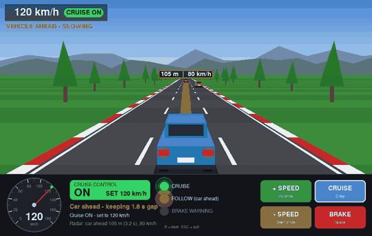
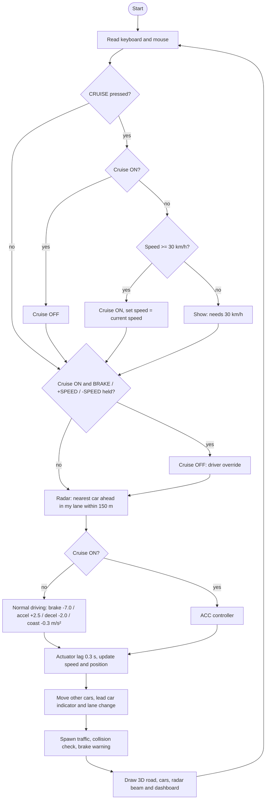
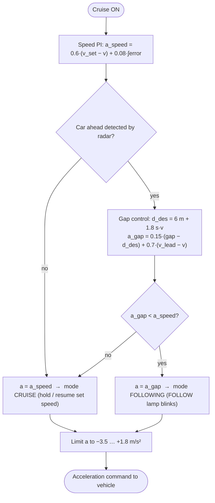
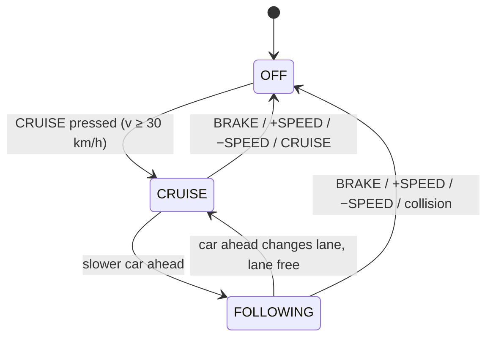
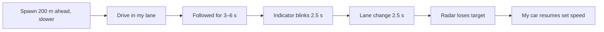

# 3D Adaptive Cruise Control Simulator (pygame)




A 3D highway driving simulator that demonstrates **Cruise Control / Adaptive Cruise Control (ACC)**.
The 3D view (chase camera, perspective road, 3D car models) is rendered with a small
custom projection engine on top of **pygame only**: no OpenGL, no CARLA, no GPU needed.

## Features
- **Normal driving** when cruise is OFF: you control the speed with **+ SPEED / - SPEED / BRAKE**.
- **CRUISE button**: switches cruise ON and holds the current speed (minimum 30 km/h). Press again for OFF.
- **Driver override**: pressing BRAKE, + SPEED or - SPEED switches cruise OFF, like in a real car.
- **Radar / ACC**: a slower car ahead is detected (150 m range). Your car slows down automatically
  and keeps a **1.8 s time gap**, and the amber **FOLLOW** lamp blinks.
- **Lane change of the car ahead**: it switches on its **indicator (blinker)** and moves to another lane.
  When the lane is free, your car **automatically accelerates back to the set speed**.
- **Forward collision warning**: a red BRAKE! warning when the time-to-collision is too short.
- **Dashboard**: speedometer, big **CRUISE ON / OFF** state, set speed, mode, radar distance, lamps.

## How it works

### Program flow (one frame, ~60 times per second)


### ACC controller decision


### Cruise control states


### Lead car behaviour


## Controls
| Action            | Keyboard   | On-screen button |
|-------------------|------------|------------------|
| Increase speed    | Up arrow   | + SPEED          |
| Decrease speed    | Down arrow | - SPEED          |
| Brake             | Space      | BRAKE            |
| Cruise ON / OFF   | C          | CRUISE           |
| Reset / Quit      | R / Esc    |                  |

## Run
```bash
python3 -m venv .venv
source .venv/bin/activate        # Windows: .venv\Scripts\activate
pip install -r requirements.txt
python acc_3d.py
```
Keep this project in its own folder and virtual environment so it never touches a CARLA installation.

## Tests
```bash
python -m pytest -q
```
The tests cover default normal driving, engage/disengage, cancel on brake/accel/decel, speed hold,
following at the time gap, the lead car's indicator and lane change with automatic resume,
and a 5-minute random traffic run with zero collisions. They run on every push via GitHub Actions.

## Architecture
```
acc_model.py       vehicle dynamics, traffic, CruiseControl (no pygame, unit-testable)
acc_3d.py          3D renderer (camera projection, road, car models), dashboard, input
test_acc_model.py  pytest unit tests
make_demo_gif.py   renders the scripted demo scenario to demo.gif
```

**Controller**: a speed PI controller (with anti-windup) and a gap controller
`a = K_gap*(gap - (d0 + T_gap*v)) + K_rel*(v_lead - v)` are combined with `min()` arbitration,
so the more cautious command always wins. The command is limited to -3.5 to +1.8 m/s^2 and passed
through a first-order actuator lag (tau = 0.3 s).

## Possible extensions
- Set speed +/- buttons while cruise is ON (like SET+/SET- on a steering wheel)
- Selectable time gap (1.0 / 1.5 / 2.0 s)
- Stop & Go to standstill, cut-in scenarios
- Port the controller to C and call it through ctypes
